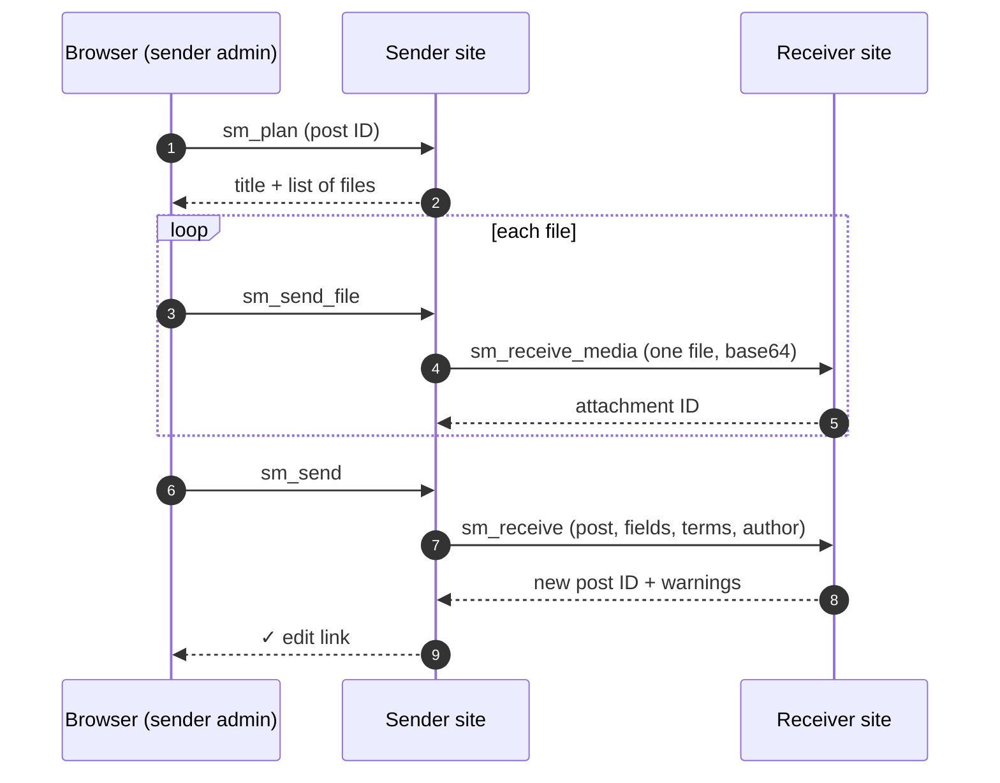

<div align="center">

# 🚚 Simple Migration

**Move hand-picked WordPress posts to another site with their authors, categories, custom fields and media.**

No export files, no SSH, no database dumps. Install the plugin on both sites, connect them with a key, tick the posts you want, and click send.

[](#-requirements)
[](#-requirements)
[](#-elementor-to-standard-content)
[](#-what-gets-migrated)
[](simple-migration.php)

[Features](#-features) · [Install](#-installation) · [Usage](#-usage) · [What migrates](#-what-gets-migrated) · [How it works](#-how-it-works) · [Troubleshooting](#-troubleshooting)

</div>

---

## ✨ Features

- **Pick exactly what moves:** browse any post type, search, page through results and select across pages, or select every match in one click.
- **Live progress:** sends one post at a time with a progress bar and a per-post log, including an "edit on receiver" link for each post that went through.
- **Brings everything a post needs:** its author, categories and tags (with their custom fields), all custom fields, the featured image, gallery and content images, and files linked from anywhere in the post.
- **Links keep working:** image URLs, attachment IDs (in blocks, ACF fields and Elementor data) and internal links are rewritten to the receiving site.
- **Safe to re-send:** sending a post again updates its earlier copy instead of duplicating it, and that includes its images.
- **Elementor to standard content (optional):** turns Elementor layouts into clean WordPress content, so the receiving site doesn't need Elementor.
- **Works on locked-down sites:** the receiver uses `admin-ajax.php` rather than the REST API, so password-protection and "disable REST" plugins don't block it.
- **Clear errors:** problems come back in plain words, e.g. a wrong key, an unreachable site, or the receiver running out of memory (with file and line).

## 📋 Requirements

| | |
|---|---|
| **PHP** | 8.0 or newer |
| **WordPress** | Developed and tested on 7.1 |
| **Both sites** | Simple Migration installed and active |
| **Network** | The sender's server must be able to reach the receiver over HTTP(S) |

## 📦 Installation

1. Download the latest code as a ZIP (**Code → Download ZIP**), or build one yourself:
   ```bash
   git clone https://github.com/ugurcanbulut/wp-simple-migration.git simple-migration
   zip -r simple-migration.zip simple-migration -x 'simple-migration/.git/*' 'simple-migration/tests/*'
   ```
2. On **both** sites, go to **Plugins → Add New → Upload Plugin**, upload the ZIP and activate it.
3. When updating an existing install, choose **Replace current with uploaded**.

## 🚀 Usage

Everything lives under **Tools → Simple Migration**.

**On the receiving site:** copy **This site's key** from the bottom of the page.

**On the sending site:**

1. **Connect:** enter the receiver's URL and key, then click **Connect**. You'll see the receiver's site name and upload size limit, or the reason it couldn't connect.
2. **Pick posts:** choose a post type, search, and click rows to select them. Posts built with Elementor are tagged, and **Last sent here** shows what has already been sent to this receiver.
3. **Send:** optionally tick **Convert Elementor posts to standard WordPress content**, then click **Send**. Failed posts stay selected, so you can retry them with one click.

> [!TIP]
> Send a single post first and check it on the receiver before sending a large batch.

## 🧳 What gets migrated

| Item | How it's handled |
|---|---|
| **Post** | Title, content, excerpt, slug, status, dates, password, comment settings, menu order, parent page (if already sent). Any post type with an admin UI. |
| **Author** | Matched by email, then username. If missing, created with the same role, and their existing password keeps working. |
| **Categories, tags, custom taxonomies** | Missing terms are created along with their parent terms and term custom fields. The receiver's own existing terms are linked but never changed. |
| **Custom fields** | Copied exactly, including serialized and ACF data. Sender URLs are rewritten to the receiver. |
| **Featured image & media** | Each file is uploaded into the same `yyyy/mm` folder and thumbnails are regenerated. Alt text, caption and description are kept. |
| **Media references** | `wp-image-N` classes, block attributes, ACF image/file/gallery fields, Elementor widgets, plus any uploads URL in content or fields (resized `-300x200`, `-scaled`, srcset, CSS backgrounds). |
| **Edited images** | Images cropped or rotated in WordPress (`…-e1764412279817.jpg`) are sent as the edited version, with matching thumbnail names. |
| **Elementor** | Layout data is copied and its image IDs remapped, or converted to standard content (see below). |

**Not migrated (yet):** comments, revisions, menus, ACF *post object / relationship* links to other posts, and plugin settings.

## 🎨 Elementor to standard content

With the **Convert Elementor posts** toggle on, each Elementor post is rendered on the sender and stored as plain post content:

- ✅ **Kept:** headings, paragraphs, bold and italic, lists, links and buttons (as links), images, tables, quotes and embeds. Video widgets become a URL on its own line, which WordPress embeds automatically.
- 🗑️ **Dropped:** layout wrappers, styling, scripts, icons, spacers and forms, all `_elementor*` data, and Elementor page templates.
- 🖼️ **Images still travel:** files used anywhere in the layout, including carousels, galleries and backgrounds, are uploaded and their links rewritten.

The post then opens in the normal WordPress editor. With the toggle off, Elementor posts are copied as-is.

## ⚙️ How it works



- **Short steps:** each request moves at most one file, so memory stays small on both sites and no request runs into a server or proxy timeout.
- **Copies are tracked:** every copy is tagged with the sender URL and original ID in a `_sm_source` field. That's how re-sends find and update the earlier copy.
- **Authentication:** the receiver accepts requests only with its key in an `X-SM-Key` header, checked in constant time. An empty key disables receiving.

## 🔒 Security

- The site key works like an admin password: whoever has it can create posts and users on the receiver. Keep it private and use HTTPS.
- To change the key, edit it on the receiver. Clear it to stop accepting posts.
- Only administrators (`manage_options`) can see the page or send posts, and all admin requests are nonce-checked.
- Serialized data from the sender is unserialized with `allowed_classes => false`, so no PHP objects are created from it.

## 🩺 Troubleshooting

| Message | What it means / what to do |
|---|---|
| `Wrong key` | Copy the key again from the receiver's Tools → Simple Migration page. |
| `Receiving is turned off on that site` | The receiver's key is empty. Set one and save. |
| `Could not reach the receiver: cURL error …` | Check the URL, DNS, firewall and SSL certificate. |
| `Unexpected reply (HTTP 4xx)` | Simple Migration probably isn't active on the receiver. |
| `Receiver crashed (HTTP 500): … Allowed memory size … exhausted` | One image is too large to resize. Add `define( 'WP_MAX_MEMORY_LIMIT', '512M' );` to the receiver's `wp-config.php`, then send again. Thumbnails are completed on retry. |
| `The post arrived empty, probably larger than the receiver's post_max_size` | A single file is bigger than the receiver accepts. Raise `post_max_size` and `upload_max_filesize` there. |
| `No valid reply from this site (HTTP …)` | The sending site itself returned an error. The text after the colon is what it returned. Check the sender's PHP error log. |
| A post sent, but with a yellow warning | Some files didn't make it. The warning names them. Send the post again once fixed. |

## 🧪 Development

The plugin is a single file: [`simple-migration.php`](simple-migration.php).

[`tests/roundtrip.php`](tests/roundtrip.php) runs the full send flow inside one site, pretending the content came from another site. It covers content, fields, terms, authors, media remapping, re-sends, Elementor conversion and edited images. All database changes are rolled back and uploads go to a temp directory.

```bash
# from the WordPress root (e.g. inside `ddev ssh`)
php -d zend.assertions=1 -d assert.exception=1 \
    wp-content/plugins/simple-migration/tests/roundtrip.php [post_id]
```

Without a `post_id`, it picks the latest published post with a featured image. Output ends with `OK post <id> → <copy id>`, or stops at the first failing assertion.

## 🤝 Contributing

Issues and pull requests are welcome. Please run the round-trip test before submitting changes.
